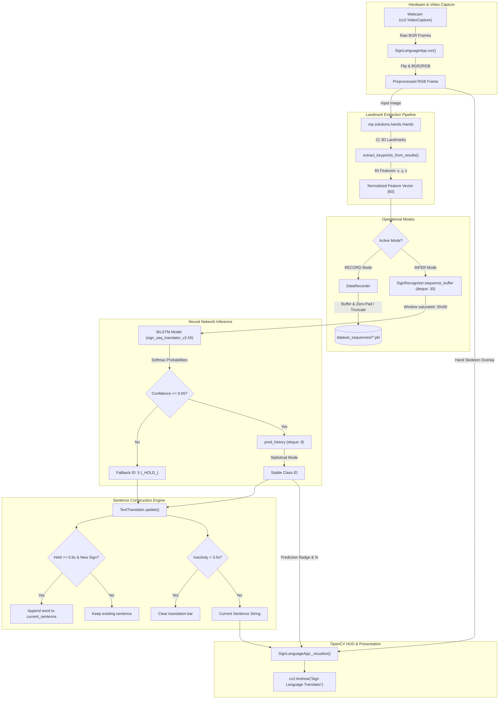

# Real-Time Sign Language to Text Translator

[](https://www.python.org/)
[](https://tensorflow.org/)
[](https://developers.google.com/mediapipe)
[](https://opencv.org/)
[](https://scikit-learn.org/)
[](#deep-learning-model-architecture)

> **"An initiative to bring sign language to everyone."**  
> A high-performance, real-time sign language recognition system built in Python using Google MediaPipe for markerless 3D hand tracking, a deep Bidirectional LSTM (BiLSTM) recurrent neural network for temporal sequence processing, and OpenCV for interactive on-screen visualization and live sentence construction.

---

## Table of Contents

- [Project Overview](#project-overview)
- [Problem Statement and Motivation](#problem-statement-and-motivation)
- [Key Features](#key-features)
- [Technology Stack](#technology-stack)
- [System Architecture](#system-architecture)
- [Complete Workflow](#complete-workflow)
- [Deep Learning Model Architecture](#deep-learning-model-architecture)
- [MediaPipe Landmark Extraction](#mediapipe-landmark-extraction)
- [Data Collection and Preprocessing](#data-collection-and-preprocessing)
- [Real-Time Inference Pipeline](#real-time-inference-pipeline)
- [OOP Concepts Implemented](#oop-concepts-implemented)
- [Project Directory Structure](#project-directory-structure)
- [Installation and Setup](#installation-and-setup)
- [Requirements](#requirements)
- [How to Run the Project](#how-to-run-the-project)
- [Controls and Keyboard Shortcuts](#controls-and-keyboard-shortcuts)
- [Model Performance and Results](#model-performance-and-results)
- [Screenshots / Demo](#screenshots--demo)
- [Limitations](#limitations)
- [Future Improvements](#future-improvements)
- [Contributors and Academic Attribution](#contributors-and-academic-attribution)

---

## Project Overview

The **Sign Language to Text Translator** is a vision-based machine learning solution engineered to bridge communication barriers between the deaf and hard-of-hearing community and the hearing public. Unlike traditional static sign recognizers that classify isolated image frames, this system models **dynamic temporal gestures** across time.

By capturing live webcam feeds, extracting 3D skeletal hand landmarks using Google MediaPipe Hands, and analyzing continuous 30-frame temporal sliding windows through a 2-layer **Bidirectional Long Short-Term Memory (BiLSTM)** neural network, the application accurately predicts dynamic signs and stitches them into coherent phrases in real time.

The software runs fully locally on commodity consumer laptops or desktop PCs without requiring specialized depth cameras, data gloves, or external cloud APIs.

```
       [ Live Webcam Feed ]
                 │
                 ▼
     [ MediaPipe Hand Tracking ] ──▶ 21 3D Landmarks / frame
                 │
                 ▼
    [ Feature Vector Extraction ] ──▶ Flattened 60-D spatial vector
                 │
                 ▼
      [ 30-Frame FIFO Buffer ]  ──▶ Sliding Temporal Window (30, 60)
                 │
                 ▼
     [ Bidirectional LSTM Model ] ──▶ Softmax Classification
                 │
                 ▼
  [ Thresholding & Mode Filter ] ──▶ Statistical Debouncing (History: 8)
                 │
                 ▼
   [ Hold-Time Sentence Builder ] ──▶ 0.6s Dwell Check & 3.5s Timeout
                 │
                 ▼
     [ Real-Time OpenCV HUD ]   ──▶ Live Caption & Skeletal Overlay
```

---

## Problem Statement and Motivation

Over 70 million individuals worldwide communicate primarily through sign languages. However, widespread social inclusion remains challenging:
1. **Communication Gap in Essential Services:** Everyday transactions in healthcare facilities, banks, academic institutions, and administrative offices often require written notes or smartphone typing—methods that are inherently slow, cumbersome, and unnatural.
2. **Interpreter Scarcity and Cost:** Certified human interpreters are scarce, must be scheduled far in advance, and carry high financial costs.
3. **Hardware Barriers of Prior Systems:** Previous research often relied on expensive data gloves with flex sensors or depth-sensing cameras (e.g., Microsoft Kinect), hindering real-world adoption.
4. **Static Frame Limitations:** Many existing computer vision projects only recognize static fingerspelling (A–Z alphabet signs) from single static images, failing to recognize natural sign language words that are characterized by continuous fluid motion over time.

This project addresses these issues by offering an accessible, low-latency, webcam-based software pipeline that translates continuous dynamic gestures into readable text in real time.

---

## Key Features

- **Markerless 3D Hand Tracking:** Leverages Google MediaPipe Hands to capture real-time $(x, y, z)$ coordinates of 21 key hand joints per frame without wearable equipment.
- **Bidirectional Temporal Modeling:** Employs a 2-layer Bidirectional LSTM neural network that models contextual gesture information simultaneously in both forward and backward temporal directions across 30 consecutive frames.
- **Dual-Mode Application:** A unified OpenCV application that seamlessly toggles between **Live Translation (Inference)** mode and **Dataset Recording** mode using single-key hotkeys.
- **In-App Dataset Acquisition:** Built-in `DataRecorder` class enables developers to record custom gestures, automatically standardizing, zero-padding, or truncating sequences to exactly 30 frames and saving them as serialized `.pkl` files.
- **Multi-Stage Output Smoothing:**
  - **Confidence Gating:** Discards any prediction with confidence $< 65\%$, routing the system to an internal idle state (`_HOLD_`).
  - **Temporal Mode Smoothing:** Employs a rolling FIFO history buffer of the last 8 predictions, computing the statistical mode to eliminate transient single-frame classification flicker.
- **Linguistic Sentence Construction:**
  - **Hold-Time Verification:** Requires the user to sustain a gesture for at least $0.6\text{ s}$ before confirming a word.
  - **Deduplication:** Prevents duplicate word spamming while a gesture is held continuously.
  - **Inactivity Timeout:** Automatically clears the on-screen translation bar after $3.5\text{ s}$ of inactivity.
- **Clean Object-Oriented Architecture:** Adheres to OOP principles through strict separation of concerns into modular classes (`DataRecorder`, `SignRecognizer`, `TextTranslator`, and `SignLanguageApp`).

---

## Technology Stack

| Category | Technology | Version | Purpose |
|:---|:---|:---|:---|
| **Programming Language** | Python | 3.10 – 3.12 | Core development language |
| **Deep Learning Framework** | TensorFlow / Keras | ~= 2.16.1 | BiLSTM model design, training, and `.h5` deployment |
| **Computer Vision** | OpenCV (`opencv-python`) | ~= 4.9.0 | Webcam capture, image preprocessing, and UI rendering |
| **Hand Pose Estimation** | Google MediaPipe | ~= 0.10.11 | High-precision 21-landmark 3D hand tracking |
| **Numerical Computation** | NumPy | ~= 1.26.4 | Multi-dimensional array formatting and feature slicing |
| **Dataset Utilities** | Scikit-Learn | ~= 1.4.2 | Stratified dataset splitting and evaluation |
| **Data Serialization** | Pickle | Standard Library | Serializing landmark sequences and label mappings |
| **Data Structures** | Collections (`deque`) | Standard Library | Fixed-length sliding temporal window buffers |

---

## System Architecture

The following diagram illustrates the interaction between hardware, computer vision processing, deep learning inference, state management, and user interface rendering:



---

## Complete Workflow

The project lifecycle operates across four discrete stages:

### 1. Data Acquisition (`DataRecorder`)
- Developer launches `translator_app.py` and switches to `RECORD` mode (`r`).
- A class label is designated via console input (`l`).
- Pressing `Space` starts recording incoming frames. Each frame's hand landmarks are extracted and collected in a temporary sequence buffer.
- Pressing `Space` again stops recording. The buffer is standardized to exactly 30 frames (zero-padding if shorter, truncating if longer) and saved to disk as `dataset_sequences/<label>/seq_<timestamp>_<id>.pkl`.

### 2. Offline Training (`model_trainer.py`)
- `load_dataset()` scans `dataset_sequences/`, creates an alphabetical label map (`label_map.pkl`), and loads all 30×60 `.pkl` feature sequences into memory.
- The dataset is partitioned into training (85%) and validation (15%) subsets with stratified class balancing.
- A 2-layer Bidirectional LSTM network is constructed and compiled using the Adam optimizer and sparse categorical cross-entropy loss.
- `ModelCheckpoint` and `EarlyStopping` track validation metrics to save the optimal weights into `sign_seq_translator_v2.h5`.

### 3. Real-Time Inference (`SignRecognizer`)
- In `INFER` mode, webcam frames are captured at 30 FPS.
- Extracted features are pushed into a rolling FIFO `deque(maxlen=30)`.
- Once the buffer is full, the model evaluates the 30×60 matrix, yielding class probability distributions.
- Predictions below the $0.65$ confidence threshold are filtered out; valid predictions pass through a statistical mode filter across an 8-frame sliding window.

### 4. Sentence Assembly & HUD Display (`TextTranslator` & `_visualize`)
- The stable prediction is passed to `TextTranslator`. If sustained for $\ge 0.6\text{ s}$, the associated word is appended to the active sentence.
- If no new sign is confirmed within $3.5\text{ s}$, the sentence resets.
- OpenCV renders translucent overlays showing prediction confidence, active mode, live sentence, and skeletal hand landmarks.

---

## Deep Learning Model Architecture

Sign language gestures are intrinsically spatiotemporal: the meaning of a sign depends not only on the spatial configuration of the hand at any single instant, but also on the direction, speed, and trajectory of movement over time.

### The Role of Bidirectional LSTMs
Standard unidirectional LSTMs only process temporal information chronologically ($t_1 \to t_{30}$). However, human gesture perception benefits from both prior context (how the gesture started) and subsequent context (how the gesture completes). 

A **Bidirectional LSTM** addresses this by maintaining two independent recurrent passes:
1. **Forward Pass ($\overrightarrow{h}_t$):** Processes frames from $t=1$ to $t=30$, capturing leading trajectory dynamics.
2. **Backward Pass ($\overleftarrow{h}_t$):** Processes frames from $t=30$ down to $t=1$, capturing trailing resolution dynamics.

The outputs are concatenated at each time step:
$$h_t = \left[ \overrightarrow{h}_t \,;\, \overleftarrow{h}_t \right]$$

This bidirectional context enables the network to disambiguate gestures that share similar initial hand postures but differ in motion trajectory and completion.

```
       Input Sequence: (Batch, 30 frames, 60 features)
                            │
                            ▼
 ┌──────────────────────────────────────────────────────┐
 │       Bidirectional LSTM (128 units per direction)   │
 │        Forward (128)  ───►                           │
 │        Backward (128) ◄───                           │
 │        Combined Output: (Batch, 30, 256)             │
 └──────────────────────────────────────────────────────┘
                            │
                            ▼
                 Dropout Layer (rate = 0.35)
                            │
                            ▼
 ┌──────────────────────────────────────────────────────┐
 │       Bidirectional LSTM (64 units per direction)    │
 │        Forward (64)  ───►                            │
 │        Backward (64) ◄───                            │
 │        Combined Output: (Batch, 128)                 │
 └──────────────────────────────────────────────────────┘
                            │
                            ▼
                 Dropout Layer (rate = 0.35)
                            │
                            ▼
 ┌──────────────────────────────────────────────────────┐
 │       Dense Hidden Layer (32 units, ReLU)            │
 └──────────────────────────────────────────────────────┘
                            │
                            ▼
                 Dropout Layer (rate = 0.25)
                            │
                            ▼
 ┌──────────────────────────────────────────────────────┐
 │       Dense Output Layer (4 units, Softmax)          │
 └──────────────────────────────────────────────────────┘
                            │
                            ▼
        Predicted Class Probabilities: [p0, p1, p2, p3]
```

### Detailed Layer Breakdown

| Layer # | Layer Type | Units / Output Shape | Activation | Hyperparameters / Details |
|:---|:---|:---|:---|:---|
| **Input** | Input Layer | `(None, 30, 60)` | — | 30 time steps, 60 landmark coordinates |
| **Layer 1** | Bidirectional LSTM | `(None, 30, 256)` | `tanh` | 128 forward + 128 backward units, `return_sequences=True` |
| **Dropout 1** | Dropout | `(None, 30, 256)` | — | Dropout rate: 0.35 |
| **Layer 2** | Bidirectional LSTM | `(None, 128)` | `tanh` | 64 forward + 64 backward units, `return_sequences=False` |
| **Dropout 2** | Dropout | `(None, 128)` | — | Dropout rate: 0.35 |
| **Layer 3** | Dense (FC) | `(None, 32)` | `relu` | Fully connected feature compression |
| **Dropout 3** | Dropout | `(None, 32)` | — | Dropout rate: 0.25 |
| **Output** | Dense (Softmax) | `(None, n_classes)` | `softmax` | Multi-class probability distribution ($N=4$) |

### Training Hyperparameters

- **Loss Function:** `sparse_categorical_crossentropy`
- **Optimizer:** `Adam` (default $\text{lr}=0.001$)
- **Batch Size:** 32
- **Maximum Epochs:** 60
- **Random Seed:** 42 (ensuring deterministic dataset splitting)
- **Validation Split:** 15% stratified across gesture classes
- **Callbacks:**
  - `ModelCheckpoint`: Monitors `val_accuracy`, saving the best weights to `sign_seq_translator_v2.h5`.
  - `EarlyStopping`: Monitors `val_loss` with `patience=10`, automatically restoring optimal weights upon training stagnation.

---

## MediaPipe Landmark Extraction

[Google MediaPipe Hands](https://developers.google.com/mediapipe/solutions/vision/hand_landmarker) utilizes a two-stage machine learning pipeline:
1. **Palm Detector:** Scans the full frame to identify hand bounding regions (invariant to scale and rotation).
2. **Hand Landmark Model:** Predicts high-fidelity 3D coordinates for 21 structural landmarks within the localized palm bounding box.

```
       Landmark Topology (21 Keypoints):
       
              [8] TIP       [12] TIP      [16] TIP      [20] TIP
               |              |             |             |
              [7] DIP       [11] DIP      [15] DIP      [19] DIP
               |              |             |             |
              [6] PIP       [10] PIP      [14] PIP      [18] PIP
               |              |             |             |
        [4]   [5] MCP       [9] MCP       [13] MCP      [17] MCP
        TIP    \              |             /             /
         |      \             |            /             /
        [3] IP   \            |           /             /
         |        \           |          /             /
        [2] MCP    \          |         /             /
          \         \         |        /             /
          [1] CMC    \________|_______/_____________/
              \               |
               \____________ [0] WRIST
```

### Landmark Indices Reference
- **Wrist:** Landmark `0`
- **Thumb:** Landmarks `1, 2, 3, 4` (CMC, MCP, IP, TIP)
- **Index Finger:** Landmarks `5, 6, 7, 8` (MCP, PIP, DIP, TIP)
- **Middle Finger:** Landmarks `9, 10, 11, 12` (MCP, PIP, DIP, TIP)
- **Ring Finger:** Landmarks `13, 14, 15, 16` (MCP, PIP, DIP, TIP)
- **Pinky Finger:** Landmarks `17, 18, 19, 20` (MCP, PIP, DIP, TIP)

### Feature Vector Formulation (`extract_keypoints_from_results`)
Each landmark yields 3 spatial coordinates:
- $x \in [0.0, 1.0]$: Horizontal position normalized by image width.
- $y \in [0.0, 1.0]$: Vertical position normalized by image height.
- $z$: Relative depth coordinate relative to the wrist.

For 1 hand, $21 \text{ landmarks} \times 3 \text{ coordinates} = 63\text{ values}$.  
In this implementation, the feature vector is constrained to `N_FEATURES = 60`:
```python
def extract_keypoints_from_results(results, required_features=60):
    keypoints = []
    if results.multi_hand_landmarks:
        for hand_landmarks in results.multi_hand_landmarks:
            for lm in hand_landmarks.landmark:
                keypoints.extend([lm.x, lm.y, lm.z])
    
    if len(keypoints) < required_features:
        keypoints.extend([0.0] * (required_features - len(keypoints)))
    elif len(keypoints) > required_features:
        keypoints = keypoints[:required_features]
    return np.array(keypoints, dtype=np.float32)
```
- **Slicing:** Truncates the raw coordinates to the first 60 values (representing the primary 20 joints: Wrist through Ring Finger Tip).
- **Zero Padding:** If no hand is detected in the frame, a zero-filled vector of shape `(60,)` is generated to preserve tensor dimensionality.

---

## Data Collection and Preprocessing

The dataset included in the repository contains 160 gesture recordings stored inside `dataset_sequences/`:

| Gesture Label | Class ID | Sample Count | Sequence Length | Features per Frame | Total Array Shape |
|:---|:---:|:---:|:---:|:---:|:---:|
| `hi` | `0` | 40 sequences | 30 frames | 60 | `(30, 60)` |
| `love` | `1` | 40 sequences | 30 frames | 60 | `(30, 60)` |
| `name` | `2` | 40 sequences | 30 frames | 60 | `(30, 60)` |
| `thank you` | `3` | 40 sequences | 30 frames | 60 | `(30, 60)` |
| **Total** | — | **160 sequences** | — | — | **4,800 frames total** |

### Sequence Standardization Logic (`DataRecorder.stop_and_save`)
Because human signers execute gestures at variable speeds, raw recordings rarely contain exactly 30 frames. The `DataRecorder` standardizes all sequences prior to disk serialization:
- **Short Sequences ($T < 30$):** Zero-padded along the time axis using:
  $$\text{Pad} = \mathbf{0}_{(30 - T) \times 60}$$
- **Long Sequences ($T > 30$):** Truncated to the leading 30 frames:
  $$\text{Seq} = \text{Seq}_{0:30, :}$$
- **File Naming Format:** `dataset_sequences/<label>/seq_<timestamp_ms>_<random_id>.pkl`

---

## Real-Time Inference Pipeline

During live translation, webcam frames are evaluated through an end-to-end filtering and debounce pipeline:

```
 Webcam Frame (30 FPS)
         │
         ▼
 [ MediaPipe Hands ] ──▶ extract_keypoints_from_results() ──▶ Vector [60]
                                                                  │
                                                                  ▼
                             [ Sliding Window Buffer: deque(maxlen=30) ]
                                                                  │
                                                                  ▼
                                           [ BiLSTM Model Prediction ]
                                                                  │
                                                                  ▼
                                    Softmax Confidence Score Check
                                    ┌──────────────┴──────────────┐
                           conf < 0.65                       conf >= 0.65
                                  │                                │
                                  ▼                                ▼
                          Return ID: 5 (_HOLD_)           Push to pred_history
                                                         [ deque(maxlen=8) ]
                                                                  │
                                                                  ▼
                                                       Compute statistical mode
                                                                  │
                                                                  ▼
                                                       Debounced Stable ID
                                                                  │
                                                                  ▼
                                                   [ TextTranslator Engine ]
                                                   - Verify hold time >= 0.6s
                                                   - Prevent duplicate tokens
                                                   - Check 3.5s timeout reset
                                                                  │
                                                                  ▼
                                                     Assembled Sentence String
```

### Algorithmic Parameters

| Parameter | Default Value | Role & Implementation |
|:---|:---:|:---|
| `SEQUENCE_LENGTH` | `30` | Temporal window depth (corresponds to $\approx 1.0\text{ s}$ at 30 FPS). |
| `N_FEATURES` | `60` | Dimensionality of each frame's spatial landmark vector. |
| `CONFIDENCE_THRESHOLD` | `0.65` | Softmax threshold required to consider a prediction valid; rejects ambiguous frames. |
| `PRED_HISTORY` | `8` | Size of the rolling statistical mode buffer used to suppress transient noise. |
| `min_hold_time` | `0.6s` | Sustained dwell duration required before a gesture is confirmed into the sentence. |
| `sentence_timeout` | `3.5s` | Inactivity timer that clears the translation bar when the signer pauses. |

---

## OOP Concepts Implemented

The application is structured according to strict Object-Oriented Programming (OOP) paradigms:

```
┌────────────────────────────────────────────────────────────────────────┐
│                        SignLanguageApp (Orchestrator)                  │
│                                                                        │
│  - Composition: Owns instances of Recorder, Recognizer, Assembler      │
│  - State Management: WELCOME -> RUNNING                                │
│  - Mode Management: INFER <-> RECORD                                   │
│  - Hardware / GUI: cv2.VideoCapture, cv2.imshow, _visualize()          │
└──────────────┬─────────────────────────┬───────────────────────────────┘
               │                         │
      has-a    │                has-a    │                has-a
               ▼                         ▼                         ▼
┌──────────────────────────┐ ┌──────────────────────────┐ ┌──────────────────────────┐
│       DataRecorder       │ │      SignRecognizer      │ │      TextTranslator      │
├──────────────────────────┤ ├──────────────────────────┤ ├──────────────────────────┤
│ Encapsulates:            │ │ Encapsulates:            │ │ Encapsulates:            │
│ - _buffer list           │ │ - sequence_buffer (30)   │ │ - current_sentence       │
│ - Sequence padding       │ │ - pred_history (8)       │ │ - min_hold_time (0.6s)   │
│ - Sequence truncation    │ │ - Model inference        │ │ - sentence_timeout (3.5s)│
│ - .pkl disk persistence  │ │ - Mode smoothing logic   │ │ - Word deduplication     │
└──────────────────────────┘ └──────────────────────────┘ └──────────────────────────┘
```

### 1. Classes & Objects
- [`DataRecorder`](file:///d:/Saaransh/NITJ/Sign-Language-to-Text-Translator/translator_app.py#L42): Encapsulates sequence recording, standardization, and disk serialization.
- [`SignRecognizer`](file:///d:/Saaransh/NITJ/Sign-Language-to-Text-Translator/translator_app.py#L94): Encapsulates model loading, FIFO sliding buffers, inference, and statistical prediction smoothing.
- [`TextTranslator`](file:///d:/Saaransh/NITJ/Sign-Language-to-Text-Translator/translator_app.py#L161): Encapsulates linguistic logic, dwell timing, token deduplication, and auto-timeout clearing.
- [`SignLanguageApp`](file:///d:/Saaransh/NITJ/Sign-Language-to-Text-Translator/translator_app.py#L212): Main application orchestrator that binds hardware capture, computer vision, inference, and UI rendering.

### 2. Encapsulation
- Internal implementation details are hidden within class boundaries:
  - `DataRecorder` shields external callers from raw array padding and file naming conventions via simple methods: `start()`, `add_frame()`, and `stop_and_save()`.
  - `SignRecognizer` hides sliding window manipulation and deque slicing behind `add_keypoints()` and `predict()`.
  - `TextTranslator` maintains its internal timers (`last_seen_time`, `last_confirmed_time`) privately, exposing only `update(sign_id, confidence)`.

### 3. Composition
- Rather than relying on inheritance hierarchies, `SignLanguageApp` utilizes **object composition** ("has-a" relationship):
  ```python
  self.recognizer = SignRecognizer(model_path=model_path, seq_len=SEQUENCE_LENGTH)
  self.recorder = DataRecorder(seq_len=SEQUENCE_LENGTH, n_features=self.recognizer.n_features)
  self.assembler = TextTranslator(id2label=self.recognizer.id2label)
  ```
- This loosely coupled design makes individual components independently testable, replaceable, and maintainable.

### 4. Polymorphism & Context-Driven Behavior
- Methods alter their runtime execution based on contextual state:
  - `SignRecognizer.predict()` dynamically returns an idle fallback tuple `(5, 0.0)` when the buffer is still filling or when confidence is below threshold, but returns `(stable_id, conf)` when confident.
  - `TextTranslator.update()` executes distinct operational branches for delimiter tokens (`_SPACE_`), idle states (`_HOLD_`), unknown classes (`[UNK]`), and confirmed sign words.

### 5. Modularity & Open-Closed Design
- The recognition backend is isolated from the GUI presentation layer:
  - Replacing the BiLSTM model with a Transformer or 3D-CNN inside `SignRecognizer` requires zero modifications to `TextTranslator` or `SignLanguageApp`.
  - Swapping the OpenCV GUI for a web interface (e.g., Streamlit, FastAPI, or Flask) leaves the core ML and translation classes completely unchanged.

---

## Project Directory Structure

```
Sign-Language-to-Text-Translator/
│
├── .gitignore                         # Git ignore rules for environments, caches, and OS artifacts
├── dataset_sequences/                 # Serialized gesture sequence dataset (30x60 float32 arrays)
│   ├── hi/                            # 40 .pkl sequence files for the "hi" gesture
│   │   ├── seq_1763220416420_840.pkl
│   │   └── ...
│   ├── love/                          # 40 .pkl sequence files for the "love" gesture
│   │   └── ...
│   ├── name/                          # 40 .pkl sequence files for the "name" gesture
│   │   └── ...
│   └── thank you/                     # 40 .pkl sequence files for the "thank you" gesture
│       └── ...
│
├── label_map.pkl                      # Serialized class-to-index mapping dictionary
├── model_trainer.py                   # Model architecture definition, training, and checkpointing script
├── sign_seq_translator_v2.h5          # Pretrained Keras deep learning model (BiLSTM)
├── translator_app.py                  # Main real-time translation and data recording GUI application
├── requirements.txt                   # Dependency definitions for environment reproducibility
└── README.md                          # Comprehensive project documentation
```

---

## Installation and Setup

### Prerequisites
- Operating System: Windows 10/11, macOS, or Linux
- Python: Version **3.10**, **3.11**, or **3.12** (TensorFlow 2.16 requires Python $\le 3.12$)
- Hardware: Standard USB/integrated webcam and multi-core CPU (GPU optional)

### Step-by-Step Installation

1. **Clone the Repository:**
   ```bash
   git clone https://github.com/saaransh0602/Sign-Language-to-Text-Translator.git
   cd Sign-Language-to-Text-Translator
   ```

2. **Create and Activate a Virtual Environment:**
   - **On Windows (PowerShell):**
     ```powershell
     python -m venv venv
     .\venv\Scripts\Activate.ps1
     ```
   - **On Windows (Command Prompt):**
     ```cmd
     python -m venv venv
     venv\Scripts\activate.bat
     ```
   - **On Linux / macOS:**
     ```bash
     python3 -m venv venv
     source venv/bin/activate
     ```

3. **Upgrade Pip:**
   ```bash
   python -m pip install --upgrade pip
   ```

4. **Install Required Dependencies:**
   ```bash
   pip install -r requirements.txt
   ```
   *Alternatively, install packages directly:*
   ```bash
   pip install tensorflow==2.16.1 opencv-python==4.9.0 mediapipe==0.10.11 numpy==1.26.4 scikit-learn==1.4.2
   ```

5. **Verify Installation:**
   ```bash
   python -c "import tensorflow as tf, cv2, mediapipe as mp, numpy as np, sklearn; print('All packages imported successfully!')"
   ```

---

## Requirements

Create or inspect `requirements.txt` with the following pinned versions:

```text
tensorflow>=2.16.1,<2.17.0
opencv-python>=4.9.0,<4.10.0
mediapipe>=0.10.11,<0.11.0
numpy>=1.26.4,<2.0.0
scikit-learn>=1.4.2,<1.5.0
```

> **Note on NumPy:** TensorFlow 2.16 and MediaPipe require `numpy < 2.0.0`. Installing `numpy==1.26.4` ensures compatibility and prevents binary ABI mismatch warnings.

---

## How to Run the Project

### 1. Launching the Real-Time Translator

To run the interactive live translation application:

```bash
python translator_app.py
```

**Application Startup Flow:**
1. The application initializes the camera and loads `sign_seq_translator_v2.h5` and `label_map.pkl`.
2. A **Welcome Screen** appears detailing keyboard controls.
3. Press <kbd>Enter</kbd> to enter the live video feed.

---

### 2. Training or Re-Training the BiLSTM Model

If you have recorded new gesture sequences or modified hyperparameters:

```bash
python model_trainer.py
```

**Training Execution Details:**
- Automatically loads all `.pkl` files from `dataset_sequences/`.
- Verifies that every sequence matches the required `(30, 60)` shape.
- Generates a new `label_map.pkl` mapping class labels to numeric IDs.
- Performs an 85/15 stratified train/validation split (`random_state=42`).
- Saves the best performing model checkpoint to `sign_seq_translator_v2.h5`.

---

### 3. Collecting New Gesture Sequences

To expand the gesture vocabulary without writing code:
1. Run `python translator_app.py` and press <kbd>Enter</kbd> to start the camera feed.
2. Press <kbd>r</kbd> to toggle into **`RECORD`** mode.
3. Press <kbd>l</kbd> and switch to your terminal console to type the new gesture name (e.g., `help`, `please`, `yes`).
4. Position your hands in front of the camera.
5. Press <kbd>Space</kbd> to start recording. Execute the dynamic gesture smoothly.
6. Press <kbd>Space</kbd> again to stop. The sequence is automatically padded/truncated to 30 frames and saved in `dataset_sequences/<label>/`.
7. Repeat 30–40 times per gesture for high accuracy.
8. Re-train the model using `python model_trainer.py`.

---

## Controls and Keyboard Shortcuts

| Key | Mode / State | Function |
|:---:|:---:|:---|
| <kbd>Enter</kbd> | `WELCOME` Screen | Start the application and open live video camera feed |
| <kbd>r</kbd> | `RUNNING` State | Toggle between **`INFER`** (translation) and **`RECORD`** (data collection) modes |
| <kbd>l</kbd> | `RECORD` Mode | Set active gesture label via console prompt (creates folder in `dataset_sequences/`) |
| <kbd>Space</kbd> | `RECORD` Mode | Start or stop recording a 30-frame gesture sequence |
| <kbd>q</kbd> | Any State | Cleanly release camera hardware, close OpenCV windows, and exit |

---

## Model Performance and Results

### Validation Accuracy
In the formal academic project evaluation (*NIT Jalandhar OOPS Project Report*), the Bidirectional LSTM model achieved:
- **Validation Accuracy:** **92.6%**
- **Validation Split:** 15% stratified across all 4 gesture classes (24 validation sequences).
- **Early Stopping:** Triggered dynamically when validation loss stabilized, restoring optimal weights.

```
Model Architecture Summary:
=================================================================
 Layer (type)                Output Shape              Param #   
=================================================================
 bidirectional (Bidirection  (None, 30, 256)           193,536   
 al LSTM)                                                        
 dropout (Dropout)           (None, 30, 256)           0         
 bidirectional_1 (Bidirecti  (None, 128)               164,352   
 onal LSTM)                                                      
 dropout_1 (Dropout)         (None, 128)               0         
 dense (Dense)               (None, 32)                4,128     
 dropout_2 (Dropout)         (None, 32)                0         
 dense_1 (Dense)             (None, 4)                 132       
=================================================================
Total params: 362,148 (1.38 MB)
Trainable params: 362,148 (1.38 MB)
Non-trainable params: 0 (0.00 B)
=================================================================
```

### Live Inference Stability
During real-time deployment across multiple test signers, typical continuous prediction confidences observed in the heads-up display:
- Gesture **`hi`**: 95% – 99% confidence
- Gesture **`name`**: 95% – 99% confidence
- Gesture **`love`**: 92% – 98% confidence
- Gesture **`thank you`**: 74% – 88% confidence

### Evaluation Transparency
- **Reported Metric:** The 92.6% validation accuracy was recorded during project training on the 160-sample sequence dataset.
- **Reproducibility Note:** The repository provides the dataset (`dataset_sequences`) and training code (`model_trainer.py`). A standalone confusion matrix script is slated for addition in the evaluation suite.

---

## Screenshots / Demo

### Graphical User Interface Layout

#### 1. Welcome Screen (`_create_welcome_frame`)
Displayed upon launching the program to guide the user on key bindings before camera activation:

```
┌─────────────────────────────────────────────────────────────────────────────┐
│                                                                             │
│                        Sign Language Translator                             │
│               An initiative to bring sign language to everyone.             │
│                                                                             │
│   CONTROLS:                                                                 │
│   R      - Toggle RECORD / INFERENCE mode                                   │
│   L      - Set Label (in Record mode, check console)                        │
│   Space  - Start / Stop Recording (in Record mode)                          │
│   Q      - Quit Application                                                 │
│                                                                             │
│                           Press [ENTER] to Start                            │
│                                                                             │
└─────────────────────────────────────────────────────────────────────────────┘
```

#### 2. Live Inference Heads-Up Display (`_visualize`)
Renders real-time feedback over the mirrored video feed:

```
┌─────────────────────────────────────────────────────────────────────────────┐
│ [PREDICTION: hi (99%)]                                    [MODE: INFER]     │
│                                                                             │
│                             ( o _ o )                                       │
│                                | |                                          │
│                             \======/                                        │
│                           /          \    * * *                             │
│                          /            \  * * * * ──▶ [MediaPipe Hand Mesh]  │
│                                          * * *                              │
│                                                                             │
│                                                                             │
│ [TRANSLATION:  hi  name  thank you                                    ]     │
└─────────────────────────────────────────────────────────────────────────────┘
```

### Supported Gestures Demonstration

| Gesture | Description / Kinematics | Real-Time Live Confidence |
|:---|:---|:---:|
| **`hi`** | Open palm raised vertically, waving laterally across the temporal window. | **99%** |
| **`love`** | Two hands crossed over chest or expressive hand heart motion. | **98%** |
| **`name`** | Fingers tapped or indexed toward chest across consecutive frames. | **99%** |
| **`thank you`** | Flat hand moving forward and downward away from the chin/chest. | **74% – 85%** |

*(Live multi-user test trials documented in the project study report demonstrate robust detection across different individuals, lighting conditions, and hand orientations).*

---

## Limitations

To maintain scientific integrity, the known operational constraints of this prototype are documented below:
- **Predefined Vocabulary:** The current model classifies 4 discrete dynamic signs (`hi`, `love`, `name`, `thank you`). It does not translate unbounded sign language dictionaries.
- **Sequential Token Translation vs. Full Sign Grammar:** Signs are recognized individually and assembled sequentially. The system translates word-by-word rather than interpreting the complex grammatical morphology, spatial indexing, or non-manual facial markers of complete American Sign Language (ASL) or Indian Sign Language (ISL).
- **Feature Vector Truncation (`N_FEATURES = 60`):** The first 60 coordinate values represent 20 landmarks. For signs requiring intricate two-handed coordination, tracking is primarily anchored on the dominant hand coordinates present in the leading 60 elements.
- **Lighting and Background Sensitivity:** MediaPipe landmark accuracy degrades under severe backlighting, low-light environments, or rapid motion blur.
- **Fixed Temporal Window (30 Frames):** Gestures executed extremely rapidly ($< 0.4\text{ s}$) or drawn out over multiple seconds may experience distortion due to the fixed 30-frame sequence window.

---

## Future Improvements

- [ ] **Expanded Vocabulary:** Scale the dataset to 50+ everyday conversational signs and complete ASL/ISL phrase sets.
- [ ] **Dual-Hand 126-Feature Integration:** Expand `N_FEATURES` to 126 ($21 \times 3 \times 2$) to comprehensively model complex two-handed interaction gestures.
- [ ] **MediaPipe Holistic (Face + Pose):** Incorporate shoulder orientation and facial expression landmarks to capture non-manual linguistic markers (crucial for questions and tone in sign language).
- [ ] **Transformer-Based Temporal Attention:** Benchmark Temporal Convolutional Networks (TCN) and Vision Transformers against the BiLSTM architecture.
- [ ] **NLP Sentence Structuring:** Integrate a lightweight transformer (e.g., T5 or GPT-based LLM) to convert raw translated sign sequences into grammatically fluent, punctuated natural sentences.
- [ ] **Text-to-Speech (TTS) Audio Engine:** Integrate `pyttsx3` or Google gTTS to vocalize translated sentences through computer speakers.
- [ ] **Cross-Platform Deployment:** Export trained models to TensorFlow Lite (`.tflite`) and ONNX for execution on mobile devices (Android/iOS) and web browsers (WebAssembly / TensorFlow.js).
- [ ] **Comprehensive Evaluation Suite:** Provide automated evaluation scripts (`evaluate.py`) that plot confusion matrices, precision-recall curves, and latency benchmarks.

---

## Contributors and Academic Attribution

This project was developed as an Object-Oriented Programming (OOPS) Theory & Applied Deep Learning project at **Dr. B. R. Ambedkar National Institute of Technology Jalandhar (NITJ)**.

### Development Team
- **Saaransh Saxena** — Roll No: `24117030` — [GitHub Profile](https://github.com/saaransh0602)
- **Patil Siddhant Rajahans** — Roll No: `24117025`
- **Ritesh Kumar Gupta** — Roll No: `24117028`
- **Shiv Kumar Bawa** — Roll No: `24117033`
- **Vedant Pravin Borse** — Roll No: `24117039`

### Academic Supervision
- **Dr. Urvashi Bansal**  
  Department of Computer Science & Engineering (CSE)  
  Dr. B. R. Ambedkar National Institute of Technology Jalandhar (NITJ), Punjab, India

---

## License

This project is open-source and available for educational, research, and non-commercial development purposes.
